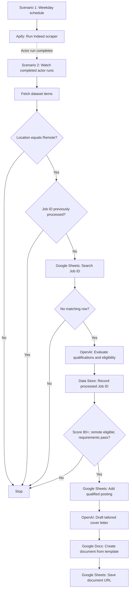

# AI Job Search & Qualification Automation

**Make.com · Apify · OpenAI · Google Sheets · Google Docs**

A two-scenario automation that discovers remote AI automation roles, identifies duplicate postings, evaluates candidate-to-role fit, and generates tailored cover-letter drafts for qualified opportunities. The system handles repetitive discovery and screening while keeping application decisions and submissions human-controlled.

## The problem

A targeted job search involves more than finding listings. Each posting needs to be checked for location eligibility, mandatory qualifications, relevant experience, and whether it has already been reviewed. Repeating those checks manually takes time, and promising opportunities still require organized tracking and tailored application materials.

This project uses workflow orchestration and an evidence-based LLM evaluation step to make that process more consistent.

## Architecture

### Scenario 1 — Job discovery

A scheduled Make.com scenario starts an Apify Indeed-scraper actor asynchronously (`runSync=false`). The configured search targets **AI Automation Specialist** roles in **Canada**, with the location set to **Remote** and a limit of **20 results per run**. Scheduling is configured in Make.com rather than stored in the exported blueprint.

### Scenario 2 — Qualification and document generation

After the Apify run completes, a second scenario retrieves the dataset and processes job postings through several checks:

1. **Remote filtering:** Passes postings whose location field exactly matches `Remote`.
2. **Duplicate prevention:** Checks the Make Data Store and the Google Sheets tracker for previously processed Job IDs.
3. **AI qualification:** Compares the job description with a verified candidate profile, including technical fit, relevant experience, mandatory requirements, and eligibility to work remotely from Ontario, Canada.
4. **Decision gate:** Continues only when `match_score >= 80`, `remote_eligibility = Yes`, and `hard_requirements = Pass`.
5. **Application preparation:** Adds the qualifying role to Google Sheets, generates a role-specific cover-letter body, creates a formatted Google Doc, and writes the document URL back to the tracker.

Every evaluated Job ID is recorded before the qualification gate, reducing repeated AI evaluations across future runs.

## Qualification scoring

| Evaluation dimension | Maximum points |
|---|---:|
| Required technical skills | 35 |
| Relevant professional experience | 25 |
| Industry and domain expertise | 20 |
| Tools and technologies | 10 |
| Role and career alignment | 10 |
| **Total** | **100** |

The score is a **custom qualification-match assessment**, not a prediction of interview or offer probability. A high score does not override an unmet mandatory requirement or geographic restriction.

The evaluation also produces structured explanations of matching qualifications, gaps, recommendation status, and reasoning. A synthetic example is available in [`examples/qualification-output.example.json`](examples/qualification-output.example.json).

## Technical design decisions

- **Event-driven processing:** Separating actor execution from result processing avoids requiring the scraping scenario to wait synchronously for the dataset.
- **Persistent deduplication:** Job IDs are checked against both a Make Data Store and the Google Sheets tracker.
- **Deterministic qualification gate:** Explicit score and eligibility conditions control whether subsequent modules execute.
- **Traceable decisions:** Scores, qualification evidence, identified gaps, and reasoning are recorded with qualified postings.
- **Human oversight:** The workflow prepares application materials but does not submit applications.
- **Cost controls:** The discovery search limits results to 20 per run, with downstream AI calls restricted to unseen postings.

## Testing and validation

The workflow has been tested through individual module executions and a controlled scenario replay:

- Job retrieval, duplicate checks, AI qualification, and rejection routing were verified through a replay of a previously scraped posting.
- Google Sheets row creation, cover-letter generation, Google Docs template population, and document-link updates were tested with fictional job data.
- The complete qualified-job path has **not yet been validated end-to-end with a genuine qualifying posting**. No claims are made about application submissions, interviews, or job placements.

## Repository contents

| Path | Purpose |
|---|---|
| [`blueprints/scenario-1-job-discovery.json`](blueprints/scenario-1-job-discovery.json) | Make.com blueprint for asynchronous job discovery |
| [`blueprints/scenario-2-ai-qualification.json`](blueprints/scenario-2-ai-qualification.json) | Make.com blueprint for screening, qualification, tracking, and cover-letter generation |
| [`docs/setup.md`](docs/setup.md) | Import and configuration requirements |
| [`docs/security-and-limitations.md`](docs/security-and-limitations.md) | Security considerations, operational risks, and implementation limitations |
| [`examples/qualification-output.example.json`](examples/qualification-output.example.json) | Synthetic example of the AI qualification response |

## Setup

See the [setup guide](docs/setup.md) for import instructions and required resources.

The blueprints are sanitized for public sharing. They retain the workflow structure but do not include working credentials, live Google resource identifiers, production data, or the original candidate profile. Running the workflows requires configuring your own Make.com connections, Apify actor, Data Store, Google Sheets tracker, Google Docs template, and candidate information.

## Responsible use

This automation supports job discovery, screening, and application preparation; it does **not** automatically apply to jobs. Users should verify job details and AI-generated assessments before acting on them, handle candidate information appropriately, and comply with the job-data source's terms and applicable privacy requirements.
